# Interview Mastery

A free, beginner-to-expert study site and Android app for product-company interviews. It covers 15 tracks and 237 modules:
DSA + Math, Java, Python, JavaScript/TypeScript, C++, C#, SQL + DBMS, Low-Level Design, High-Level System Design, Frontend (React and Angular), Backend, GenAI & Working With AI (including MCP), CS Core (OS + Networks), Cloud & DevOps, and Behavioral & Career.

- **Website:** https://shrenikyd.github.io/DSA-LEARNINGS/
- **Android app:** https://play.google.com/store/apps/details?id=io.github.shrenikyd.interviewmastery

## Screenshots

### Website
| World map | Track page |
|---|---|
| 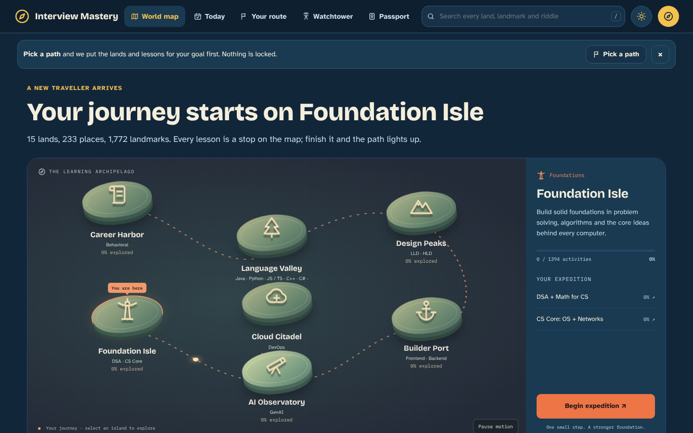 | 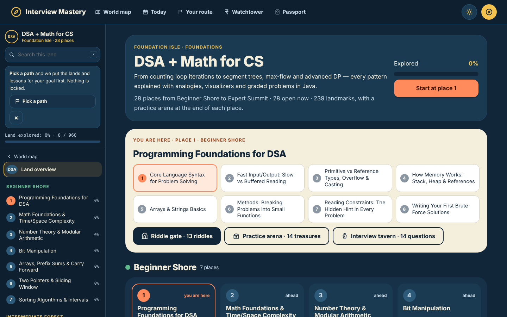 |
| **Route planner** | **Watchtower (lesson videos)** |
| 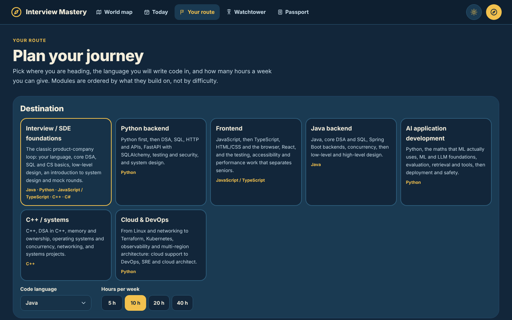 | 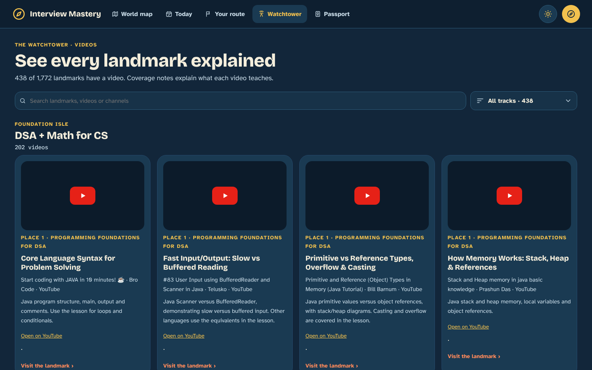 |

<p align="center">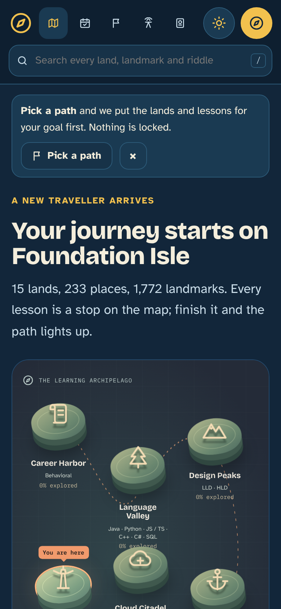</p>

### Android app
| Home | World | Concept game |
|---|---|---|
| 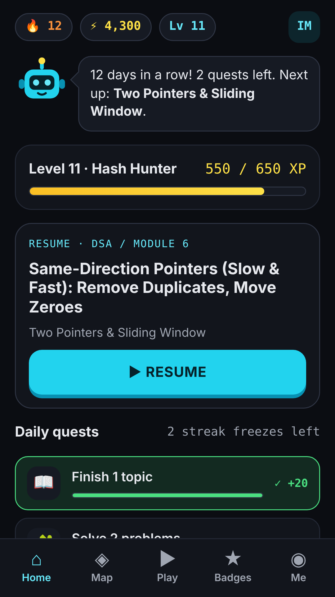 | 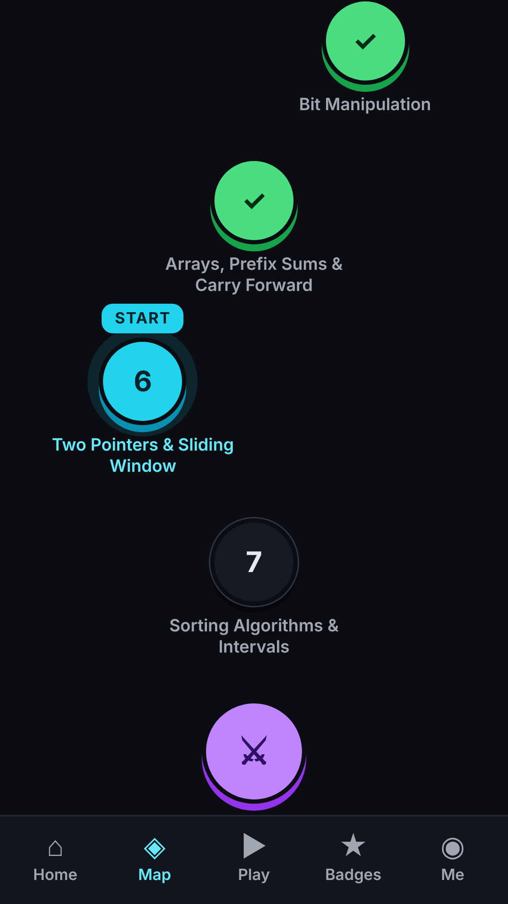 | 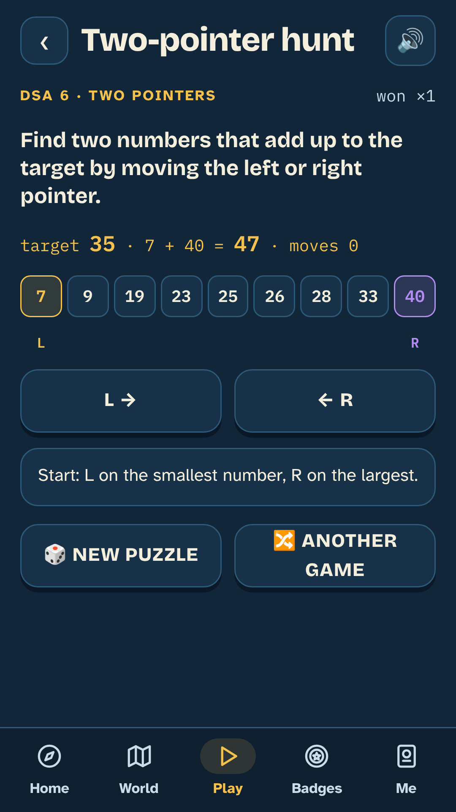 |
| **Concept game** | **Lesson with read-aloud** | **Badges** |
| 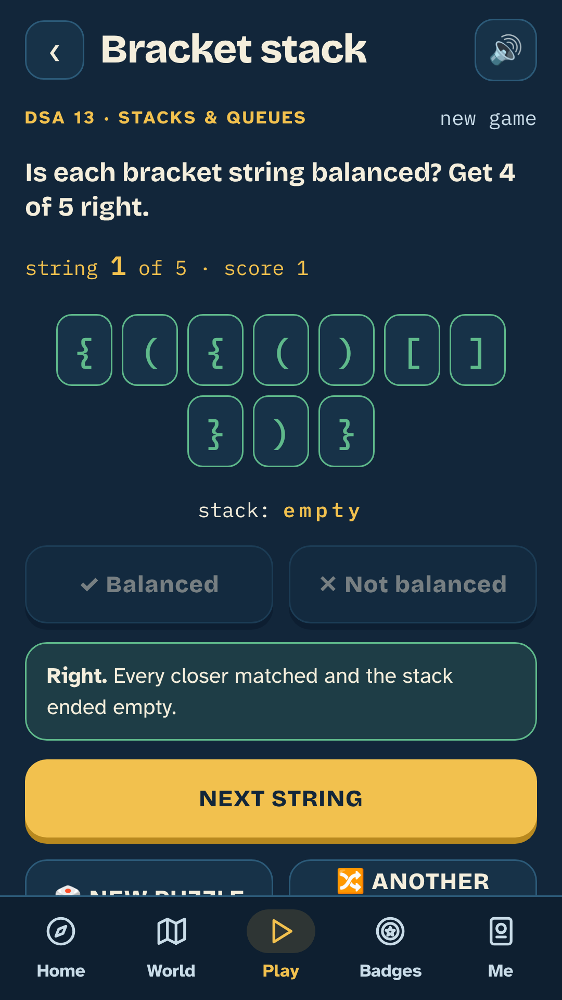 | 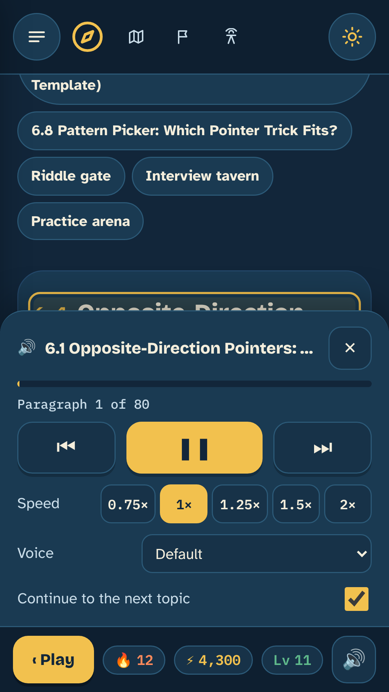 | 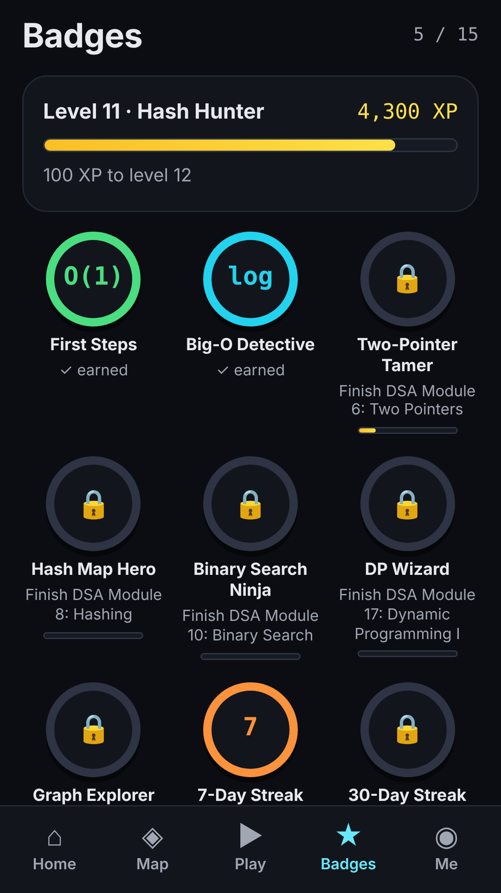 |

**Study routes (all three phases released, see [docs/RELEASE_PHASE1.md](docs/RELEASE_PHASE1.md), [docs/RELEASE_PHASE2.md](docs/RELEASE_PHASE2.md) and [docs/RELEASE_PHASE3.md](docs/RELEASE_PHASE3.md)).** Pick a career route and a language (Java, Python, JavaScript/TypeScript, C++ or C#) on the route page (`route.html`). The site orders modules by prerequisites, shows what to study next and why, gives a schedule at 5–40 hours a week, and counts a module as mastered only after a checkpoint or readiness check. Every DSA problem (28 modules) and every Low-Level Design program (12 modules) has a tested solution in all four languages, and every problem in the Java, Python, JavaScript/TypeScript, C++ and SQL tracks is tested too. Route projects have checklists that count towards progress, and CI runs every check on each change.

Every module has the same layout:
- 🎯 **Learning-path header**: goals, prerequisites and estimated hours.
- ☕ **Analogy first**: an everyday comparison, then a plain-English explanation.
- 🔍 **Clues in the question**: the phrases and constraints that point to each technique.
- 🎬 **Step-by-step visualizers** with a plain-English narrator, one on every topic.
- 📚 **Worked examples**.
- 🧩 **Guided problems**: brute force → "What would you do?" question → 3 progressive hints → full solution, dry run and complexity.
- 🟣 **Expert deep dives**.
- 🤖 **Working alongside AI**: how AI changes each topic and how to use it well.
- 📝 **Quiz** and 🎤 **interview Q&A bank**.
- 🏟 **Practice Arena** with 12–20 graded problems.

The site is styled as a story journey: the home page is a world map of 7 regions, each track is a land, each module is a place and each topic is a landmark. Progress earns 17 rubber-stamp badges on the Passport page (`passport.html`); lesson videos are collected on the Watchtower page (`videos.html`). A daily bot finds new lesson videos, redeploys the website and releases a new app version when any are added.

SQL snippets run live in the browser (sql.js), and JavaScript/Python snippets run in a sandbox.

See [docs/CURRICULUM.md](docs/CURRICULUM.md) for the full curriculum and learning paths.

## Run locally
```bash
node tools/build.js          # builds ./site
npx serve site               # or any static server (the SQL runner needs http, not file://)
```

## Mobile app (Android and iOS)
The app wraps the same lessons in a play mode: XP and levels, daily quests, streaks, an animated six-region island world, track paths with boss fights, a stamp passport, curriculum search, badges, and 34 concept games that teach an idea before the lesson does. It is built with [Capacitor](https://capacitorjs.com).

```bash
npm ci
node tools/play-test.js      # play engine unit tests
node tools/fun-test.js       # game mechanics, search, world and streak checks
node tools/app-navigation-test.js # connected app navigation and rewards
node tools/build-app.js      # builds ./app-www (lessons + play mode)
npx cap sync                 # copies app-www into android/ and ios/
npx cap open android         # Android Studio; or: cd android && ./gradlew assembleDebug
npx cap open ios             # Xcode (macOS only)
```

| Path | What |
|---|---|
| `app/` | Play mode: `play.js` (XP, levels, streaks, quests, badges), `games.js` (concept games), `app.js` (screens), `bridge.js` (XP bar on lesson pages) |
| `tools/build-app.js` | Builds the site into `app-www/` and adds play mode |
| `android/`, `ios/` | Native projects generated by Capacitor |
| `.github/workflows/android.yml` | Runs the tests and builds a debug APK on every push; download it from the run's Artifacts |

Google sign-in in the app opens Google in the system browser. Google returns to the website's `login.html?app=1` (covered by the site's existing redirect URL in Supabase), and that page hands the code back to the app through the deep link `io.github.shrenikyd.interviewmastery://login-callback`.

iPhone and iPad: install the website from Safari (Share → Add to Home Screen) or build the native app on a Mac; see [docs/IOS.md](docs/IOS.md).

Publishing on Google Play: see [docs/PLAY_RELEASE.md](docs/PLAY_RELEASE.md). Lesson videos: see [docs/VIDEOS.md](docs/VIDEOS.md).

XP and badges are worked out from the progress the website already saves, so they sync with your account. Streaks, quests and game wins are kept on the device for now.

## Versioning
The website and the mobile app have separate versions in `package.json`:
- **Website**: `version`, shown in the home page footer and listed in [CHANGELOG.md](CHANGELOG.md). To release, bump it, add a CHANGELOG entry and merge to `main`; the Pages workflow tags it `web-vX.Y.Z`.
- **App**: `appVersion`, listed in [CHANGELOG-APP.md](CHANGELOG-APP.md). To release, bump it, run `node tools/version-sync.js` (updates the iOS project; Android reads `package.json` itself), add a CHANGELOG-APP entry and merge to `main`. The Android workflow tags it `app-vX.Y.Z`, publishes a GitHub Release with the APK and uploads it to Google Play.

A website-only change does not need an app version bump, and the reverse. Up to 1.6.1 both shared one version, tagged `vX.Y.Z`.

## Project layout
| Path | What |
|---|---|
| `src/` | Engine (`engine.js`), styles, helpers, page templates, track/module registry (`tracks.js`) |
| `content/<track>/<id>.js` | One file per module (data + visualizer generators) |
| `tools/build.js` | Builds the static site into `site/` |
| `tools/validate.js` | Checks a module: structure, counts, HTML, visualizers, and that code compiles or runs (`--code`) |
| `tools/e2e.js` | Headless-browser smoke test of the built site |
| `tools/solution-check.js` | Runs every problem's tests in Java, Python, JavaScript/TypeScript and C++ (`--require java,python,js,cpp`) |
| `tools/paths-check.js` | Checks prerequisites, routes, language coverage and schedules (`--strict` for release) |
| `src/paths.js`, `src/learn.js`, `src/route.html` | Route data (prerequisites, routes, projects, schedules), mastery and review logic, and the route page |
| `docs/LANGUAGE_AUTHORING.md` | How to add tests and the four language versions to a module |
| `docs/STUDY_PATHS_PLAN.md`, `docs/RELEASE_PHASE1.md`, `docs/RELEASE_PHASE2.md`, `docs/RELEASE_PHASE3.md`, `docs/RELEASE_REVIEW.md` | The three-phase plan, the release notes for each phase, and the content review of the original 220 modules |
| `docs/AUTHORING.md` | How to write a module |
| `vendor/` | sql.js (MIT) for the in-browser SQL runner, supabase-js 2.117.2 (MIT) for accounts |
| `src/journey.js` | Journey layer: regions, zones, destinations, stamp rules and the SVG stamp artwork, top bar, Passport page |
| `src/auth.js`, `src/login.*` | Accounts: sign-in page and progress sync |
| `supabase/schema.sql` | Database table + row-level security for per-user progress |

## Deploy (GitHub Pages)
The `.github/workflows/pages.yml` workflow builds and deploys the site on every push.
One-time setup: **Settings → Pages → Build and deployment → Source: GitHub Actions**.

## Accounts and progress sync (Supabase)
Progress is always saved in the browser. Signing in also saves it to Supabase, so it follows the learner across devices.

One-time setup:
1. **Create the table:** Supabase dashboard → SQL Editor → paste [`supabase/schema.sql`](supabase/schema.sql) → Run. Row-level security lets each user read and write only their own row.
2. **Allow redirects:** Authentication → URL Configuration → set **Site URL** to the Pages URL (e.g. `https://<user>.github.io/<repo>/`) and add `https://<user>.github.io/<repo>/login.html` to **Redirect URLs** (used by confirmation and password-reset emails).
3. **Give the build your project details:** GitHub repo → Settings → Secrets and variables → Actions → **Variables** → add `SUPABASE_URL` (the project URL) and `SUPABASE_PUBLISHABLE_KEY` (the publishable key). Then re-run the Pages workflow.

The publishable key is meant to be used in browsers; data is protected by row-level security, so never put a secret/service-role key here. Without these variables the site builds with accounts turned off.

Local build with accounts: `SUPABASE_URL=... SUPABASE_PUBLISHABLE_KEY=... node tools/build.js`

## Visitor statistics (owner only)
The site and app send one anonymous record per page per day (random visitor id, page, web or app, device type, OS and browser family; no names, emails or IP addresses), and skip visitors whose browser sends Do Not Track or Global Privacy Control. Only accounts listed in `public.visit_admins` can open the dashboard at `admin.html`. Setup: run [`supabase/migrations/0006_visits.sql`](supabase/migrations/0006_visits.sql), then see [docs/DATABASE.md](docs/DATABASE.md).
